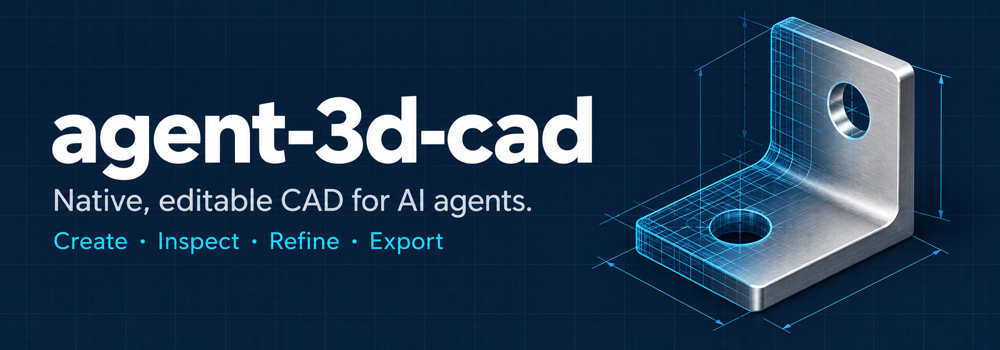

# Agent CAD

Create and refine editable CAD projects in your chat. Inspect faces and edges,
reopen saved designs, and export STEP, STL and PDF/SVG/DXF drawings.
The native CAD engine runs on your computer; the interactive viewer runs inside
an MCP Apps host. No Python, Node, Rust or compiler is needed to use a package.

## Built on Open CASCADE Technology

Agent CAD's geometry kernel is **Open CASCADE Technology (OCCT) 8.0.1**,
distributed under the GNU Lesser General Public License, version 2.1
(LGPL 2.1), with the Open CASCADE exception. Agent CAD links OCCT as shared
libraries that you may replace with a modified compatible build, and ships a
documented local modification to five OCCT hidden-line files with its patch,
complete modified sources and relinking instructions. The original Agent CAD
code is MIT-licensed, but a distributed binary bundle is a combined work whose
components keep their own licences; it is not MIT-licensed as a whole. See
[NOTICE](NOTICE) and the [third-party notices](packaging/THIRD_PARTY.md) —
installed in every bundle under `share/agent-3d-cad/notices` — for the exact
licence texts, your LGPL rights, and how to obtain the corresponding source.

## Install

Choose your host in the [setup guide](docs/GETTING_STARTED.md):

| Host | Setup |
|---|---|
| [Codex / ChatGPT desktop](docs/GETTING_STARTED.md#codex--chatgpt-desktop) | Add the local plugin, or connect the native engine through MCP |
| [Claude Desktop](docs/GETTING_STARTED.md#claude-desktop) | Install the `.mcpb` extension |
| [Grok Build](docs/GETTING_STARTED.md#grok-build) | Register the native engine with `grok mcp add` |
| [OpenCode](docs/GETTING_STARTED.md#opencode) | Add one local MCP entry to your config |
| [Other agents](docs/GETTING_STARTED.md#other-agents) | Connect a local stdio MCP server |

Get platform packages from [Releases](https://github.com/cfaulkingham/agent-3d-cad/releases).
The engine and viewer are bundled; no separate Agent CAD app is needed. Hosts
with MCP Apps show the viewer in chat; other clients can request offline HTML
or PNG previews. The standalone app has been removed from current source.

Current source/CI packages include the local plugin and default project folder.
The older `0.1.0-preview.1` downloads require an explicit project folder; see the
setup guide. Public plugin-directory listing, signing and complete host acceptance
remain [release gates](docs/RELEASE_1_0.md).

## Create your first project

Once the plugin is connected, ask:

> Create an editable 80 × 50 × 6 mm mounting plate with four mounting holes.
> Save it as mounting_plate and show it. Then make it 8 mm thick and export STEP.

The agent opens the viewer in chat. Select a face or edge and describe the edit
in your main chat. The agent reads the selected geometry. Saved changes refresh the
same view. Choose a saved model from the library to return to an older project.

Use **Export** for STEP, STL or 2D drawings. Default drawings use an A4 sheet
with standard views; ask the agent to add dimensions or customize the drawing.
The current embedded viewer reports files saved in the workspace. Convenient
file retrieval through both hosts is still required for 1.0.

Your saved model is the editable source. Exports are separate outputs; exporting
does not replace the project. Failed edits preserve the last committed revision.
Keep the project folder outside the extension installation so updates preserve it.

## Review external files

The current source can review original STEP, STL, 3MF, GLB, DXF and URDF/SDF/SRDF
robot files in the same viewer. Ask your agent to review the file with its actual
SHA-256 and explicit units. `cad_artifact` captures and validates a portable
review; `cad_artifact_show` opens it with source hashes, geometry or semantic
metadata, and format limitations.

These views are read-only. Mesh groups and curves belong to the captured review;
they do not recover original CAD face selectors or editable feature history.
A saved native project remains the editable source. Use `cad_show` to return to
that project, or explicitly import a STEP file with `cad_import` to create an
opaque native feature. Final combined validation and desktop-host acceptance
remain pending. See the [external artifact guide](docs/ARTIFACT_REVIEW.md).

## More

- [Repository layout and documentation index](docs/README.md)
- [Client setup and troubleshooting](docs/GETTING_STARTED.md)
- [Viewer and saved projects](docs/LIVE_VIEWER.md)
- [External CAD, mesh, drawing and robot review](docs/ARTIFACT_REVIEW.md)
- [Clipping and exploded inspection](docs/PRESENTATION.md)
- [Exact measurements and assembly clearance](docs/MEASUREMENTS.md)
- [Exact planar sections and material caps](docs/SECTIONS.md)
- [Colors, saved review views and PNG captures](docs/APPEARANCE.md)
- [Saved inspection notes and revision-qualified pins](docs/ANNOTATIONS.md)
- [Coordinated mechanism and presentation sequences](docs/PLAYBACK.md)
- [Modeling tools and CLI protocol](docs/PROTOCOL.md)
- [Searchable native help and verification examples](docs/NATIVE_HELP.md)
- [Shell, offset and thickening](docs/SHELL_OFFSET_THICKEN.md)
- [Exact sketch operations, mirror and split](docs/SKETCH_OPERATIONS.md)
- [Editable text, SVG and DXF](docs/AUTHORING_IMPORTS.md)
- [Extrusion extents and sweep controls](docs/RICHER_MODELING.md)
- [Sheet-metal bends and flat patterns](docs/SHEET_METAL.md)
- [Parametric surfaces, trims and shells](docs/SURFACES.md)
- [Drawings](docs/DRAWINGS.md) and [assemblies](docs/ASSEMBLIES.md)
- [Manufacturing packages](docs/MANUFACTURING.md): editable source, per-part exports,
  drawings, BOM and a portable manifest
- [Measured fabrication review](docs/FABRICATION_REVIEW.md): explicit process limits,
  geometric evidence and saved-pose clearance/interference
- [Native G-code review](docs/GCODE_REVIEW.md): explicit commanded-path checks,
  preserved original bytes and unknown firmware behavior
- [Native slicing](docs/SLICING.md): explicit installed OrcaSlicer/profile inputs,
  reviewed plans, bounded jobs and real G-code provenance
- [Printer handoff](docs/PRINTER_HANDOFF.md): portable offline plans, native
  re-verification and explicit external installation/machine prerequisites
- [Sourced parts](docs/PURCHASED_PARTS.md): verified STEP identity, reusable
  purchasing provenance and original supplier artifacts
- [Build, test, and contribute](docs/DEVELOPMENT.md)
- [Release process and packaging](docs/DISTRIBUTION.md)

## Licence

The original Agent CAD code is [MIT-licensed](LICENSE). Distributed binaries
also contain Open CASCADE Technology (LGPL 2.1 with the Open CASCADE
exception), FreeType, TinyXML2 and toolchain runtime libraries, which keep
their own licences; the combined bundle is therefore not MIT-licensed as a
whole. See [NOTICE](NOTICE) and the
[third-party notices](packaging/THIRD_PARTY.md), including the written offer
of corresponding source for the modified OCCT libraries.
